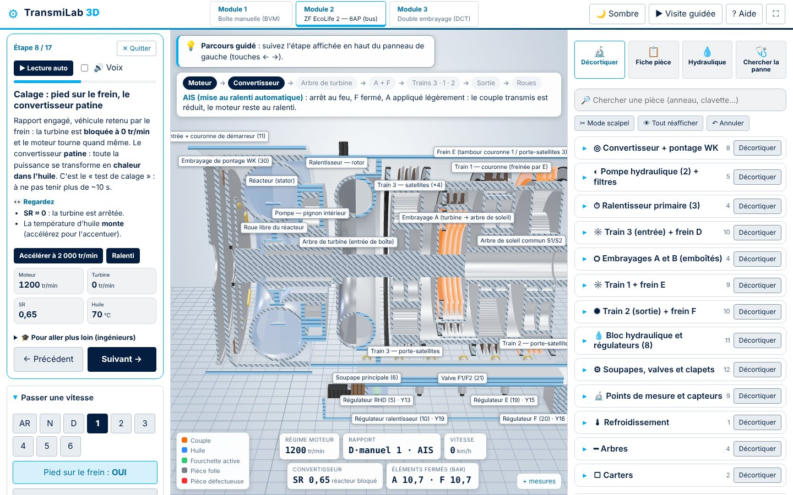
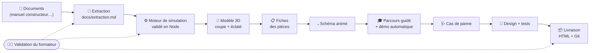
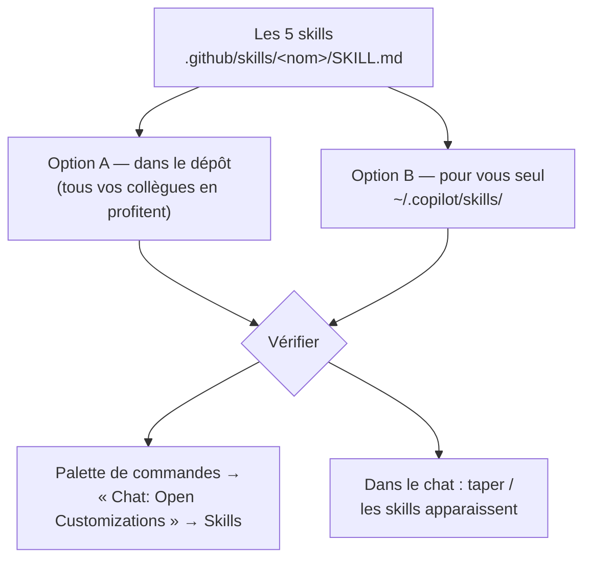
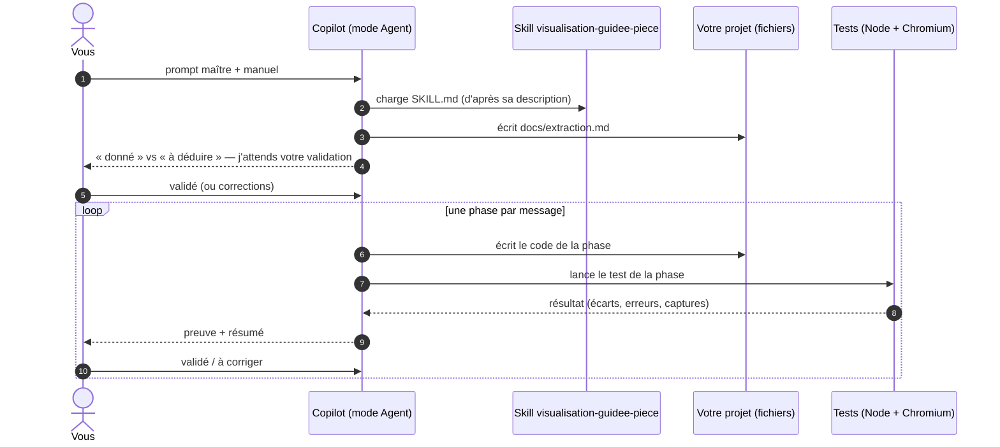
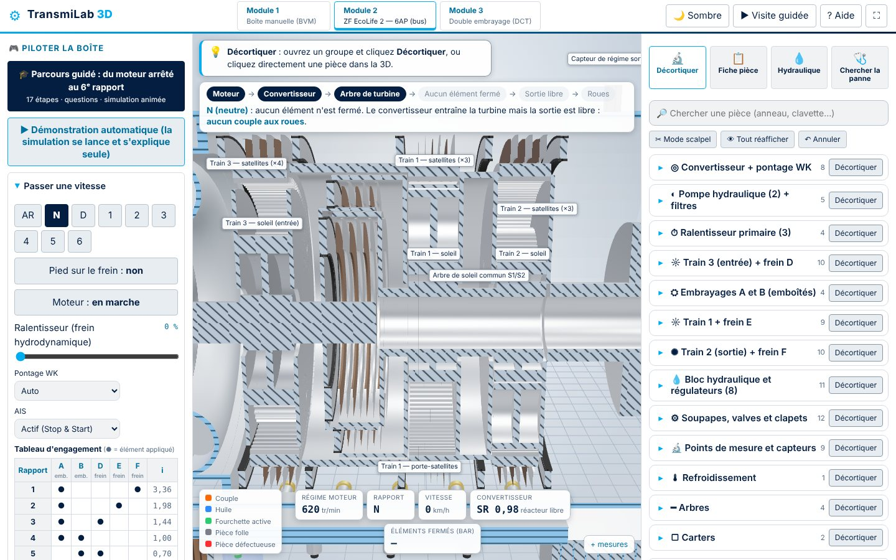
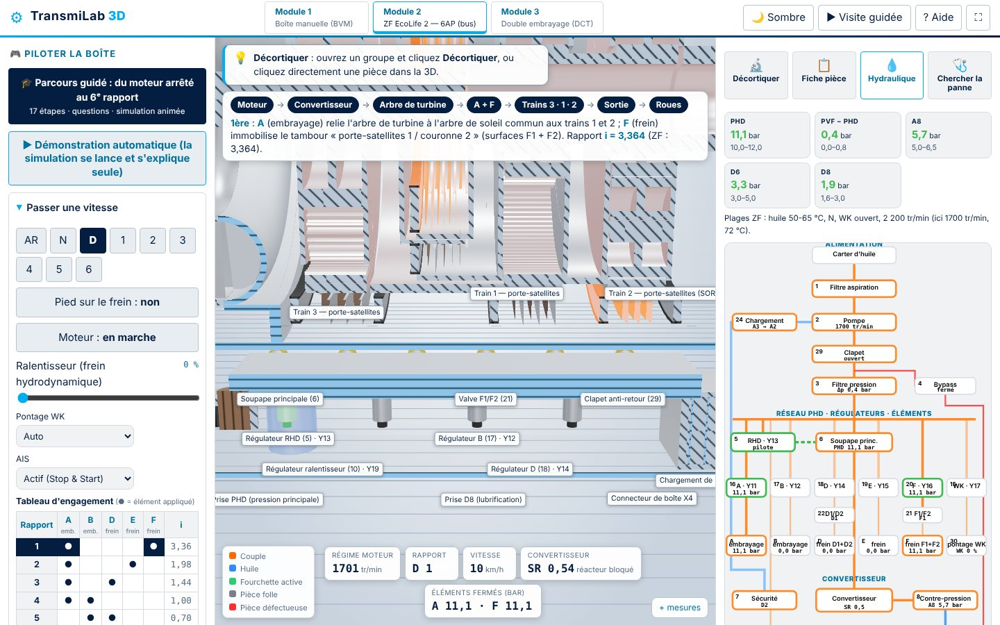
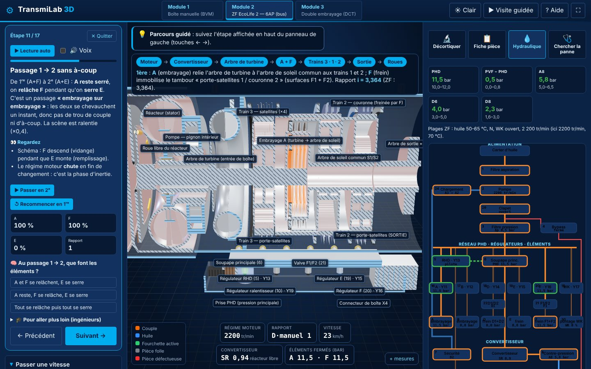
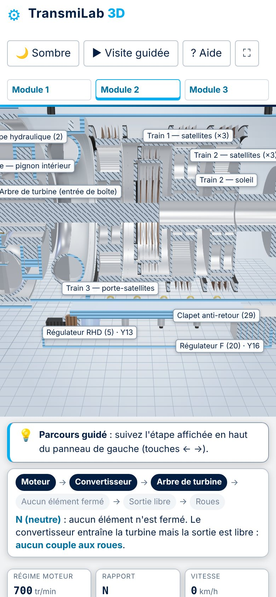

# Guide — Refaire une visualisation comme TransmiLab 3D avec GitHub Copilot

> **Objectif** : à partir d'un manuel technique, obtenir pour *votre* pièce un simulateur 3D avec coupe, schéma animé, parcours guidé « du mouvement 0 à la fin » et démonstration automatique — comme celui-ci :
>
> 

⚠ **Ce que ce guide est, et n'est pas.** Les skills du dépôt respectent le format standard *Agent Skills* (vérifié dans la documentation officielle de VS Code et de GitHub) mais **n'ont pas été testés dans votre Copilot**. Les images ci-dessous sont celles du **résultat attendu** (captures de l'application) et des **schémas** ; je n'ai pas de captures de l'interface de Copilot elle-même. Là où ça compte, le guide cite l'endroit exact indiqué par la documentation officielle.

---

## 1. Vue d'ensemble en un schéma



Vous restez le **pilote** : Copilot exécute une phase, **prouve** son résultat, et vous validez avant la suivante.

## 2. Ce qu'il faut avant de commencer

| Besoin | Détail | Vérifier |
|---|---|---|
| **VS Code** + extension **GitHub Copilot Chat** | avec le **mode Agent** (pas seulement « Ask ») | le sélecteur de mode du chat propose *Agent* |
| **Licence Copilot** | selon la politique de votre entreprise | demander à l'IT si besoin |
| **Node.js** et **Python 3** | pour les scripts (`scaffold.py`, `smoke_test.cjs`) | `node -v` · `python3 -V` |
| **Playwright + Chromium** | pour les tests navigateur | `npm i -D playwright && npx playwright install chromium` |
| **Le dépôt** | `git clone https://github.com/youssefelfahim10/transmilab3d-ecolife` | dossier ouvert dans VS Code |
| **Vos documents** | manuel constructeur, schémas… | voir [documents à fournir](../04-documents-a-fournir/DOCUMENTS-A-PREPARER.md) |

## 3. Installer les skills (déjà fait dans ce dépôt)



1. **Option A (recommandée)** : ouvrez ce dépôt tel quel ; `.github/skills/` est à la racine, c'est l'emplacement **projet** de Copilot. Pour un autre dépôt, copiez-y le dossier `.github/skills/` **entier**.
2. **Option B** : copiez les dossiers de skills dans `~/.copilot/skills/` (emplacement **personnel**), ou lancez `bash 2-COMMENT-REALISE/05-portage-copilot-librechat/installer_perso.sh` si vous avez le paquet autonome.
3. **Vérifier** — selon la documentation VS Code :
   - palette de commandes (⇧⌘P / Ctrl+Maj+P) → **Chat: Open Customizations** → onglet **Skills** ;
   - ou, dans une **nouvelle** conversation, tapez `/` : les skills apparaissent comme commandes.
4. Test minimal : `/visualisation-guidee-piece Résume en 5 lignes ta méthode.` — la réponse doit citer les 10 étapes.

**Règles de format** (si vous créez un skill) : `name` = nom du dossier, minuscules/chiffres/tirets, ≤ 64 caractères ; `description` ≤ 1 024 caractères et elle doit dire **quand** utiliser le skill. Un nom qui ne correspond pas au dossier fait **échouer le chargement sans message**.

| Skill | À quoi il sert dans ce guide |
|---|---|
| `visualisation-guidee-piece` | **le chef d'orchestre** : méthode, modèles, `scaffold.py`, `smoke_test.cjs` |
| `simulateur-3d-pedagogique` | géométrie, coupe, vue éclatée, livraison |
| `diagnostic-pedagogique-ux` | « décortiquer » et « chercher la panne » |
| `capture-webgl-headless` | tests et captures avec Chromium |
| `pptx-cinematique-depuis-app` | présentation PowerPoint |

## 4. Préparer les documents (30 à 60 minutes, une seule fois)

1. Créez `docs/sources/` et déposez-y le manuel (PDF/DOCX), le schéma hydraulique/électrique, le tableau d'engagement.
2. **Convertissez le manuel en texte** pour que l'agent le lise bien : `pandoc manuel.docx -t markdown -o docs/sources/manuel.md --extract-media=docs/sources/media` (ou `pdftotext -layout manuel.pdf docs/sources/manuel.txt`). Dans le chat, référencez-le avec `#file:docs/sources/manuel.md` (syntaxe `#file:` citée dans la documentation VS Code des skills).
3. Remplissez avec le formateur le [cahier des charges](../04-documents-a-fournir/modeles/cahier-des-charges.md) (30 min) : **ce qu'il veut voir**, le public, les critères.
4. Vérifiez le schéma cinématique : s'il manque, la simulation sera **reconstruite** et à valider (c'est le cas de l'EcoLife 2).

## 5. Lancer : le prompt maître

Ouvrez le chat Copilot en **mode Agent**, joignez/référencez le manuel, et collez le prompt court ou complet de [`PROMPT-MAITRE.md`](../03-prompts/PROMPT-MAITRE.md) (variables `[[…]]` remplies).



## 6. Dérouler les 11 phases — ce que vous envoyez, ce que vous devez voir

| Phase | Vous envoyez (extrait de `PROMPT-MAITRE.md`) | Copilot produit | **Votre contrôle** (preuve exigée) |
|---|---|---|---|
| **0 Cadrer** | « Pose-moi au plus 4 questions… puis écris l'AGENTS.md. » | `AGENTS.md` | règles du projet lisibles |
| **1 Extraire** | « Lis le manuel et écris docs/extraction.md… cite la page. » | tableaux composants / états / valeurs / **donné vs déduit** | chaque valeur a sa page ; la liste « à déduire » est honnête |
| **2 Moteur** | « Écris js/\<nom\>Sim.js selon le modèle. » | simulation avec **une** table de constantes | pas de nombre magique dupliqué |
| **3 Valider** | « Écris un test Node qui compare au manuel. » | tableau écart / valeur | **écarts < 0,1 %** — ne pas passer à la 3D sinon |
| **4 3D** | « Génère le module 3D ; lance le smoke test. » | modèle + vue éclatée + groupes | 0 erreur + capture ↓ |
| **5 Fiches** | « Écris les fiches de toutes les pièces. » | rôle · contrôle · symptôme · remontage | autant de fiches que de pièces ; valeurs sourcées |
| **6 Schéma** | « Crée le schéma animé cliquable. » | SVG + jauges aux plages du manuel | capture ↓ + un clic éclaire la pièce 3D |
| **7 Parcours** | « Écris le parcours de N étapes + le scénario AUTO. » | `lesson<Nom>.js` | `smoke_test.cjs` déroule tout, 0 erreur |
| **8 Pannes** | « Écris N cas pratiques. » | symptôme → mesures → pièce coupable | chaque cas se joue de bout en bout |
| **9 Design / tests** | « Applique la charte, teste bureau + 390 px, clair + sombre. » | 4 captures | aucun chevauchement |
| **10 Livraison** | « Construis le HTML autonome, mets à jour le README (limites). » | `dist/…html`, README | ouverture en double-clic, limites écrites |

### À quoi ressemble un bon résultat

**Phase 4 — modèle 3D en coupe** (convertisseur, trains, embrayages, freins, bloc hydraulique) :



**Phase 6 — schéma hydraulique animé** (pressions vivantes avec plages du manuel, blocs qui s'allument) :



**Phase 7 — parcours guidé** (une idée par étape, mesures en direct, question) :



**Phase 9 — mobile** (390 px, aucun défilement horizontal) :



### Les 3 réflexes qui font la différence
1. **Un message = une phase.** Demander « tout » d'un coup accumule les erreurs.
2. **Exiger une preuve** : test Node, `smoke_test.cjs`, capture. Sans preuve, la phase n'est pas finie.
3. **Garder l'honnêteté** : demander à chaque phase « liste ce qui est déduit ou simplifié » et le reporter dans le README.

## 7. Contrôler et valider

- Cochez la [recette](../04-documents-a-fournir/modeles/recette.md) (exactitude · pédagogie · technique · livraison).
- **Validation du formateur** avant diffusion : cinématique, valeurs, vocabulaire. Notez son nom et la date dans la recette.
- Commande de test navigateur (dans votre terminal) :
  ```bash
  cd 1-PROJET-REALISE && python3 -m http.server 8765        # un terminal
  NODE_PATH=$(npm root -g) node ../.github/skills/visualisation-guidee-piece/scripts/smoke_test.cjs http://localhost:8765/index.html <id_module>
  ```
  Attendu : `ERREURS : []` et la liste de toutes les étapes du parcours.

## 8. Livrer

| Livrable | Commande / action |
|---|---|
| **HTML autonome** (un fichier, hors ligne) | `cd 1-PROJET-REALISE && ./tools/build-standalone.sh` → `dist/transmilab3d.html` |
| **Dépôt Git** | commits clairs ; `.gitignore` des fichiers lourds ; README avec **limites** |
| **Git d'entreprise** | le serveur peut exiger un **jeton d'accès personnel** (pas un mot de passe) — le créer dans les paramètres du serveur, ne **jamais** le coller dans un message ou un fichier |

## 9. Dépannage

| Symptôme | Cause probable | Correction |
|---|---|---|
| Les skills n'apparaissent pas avec `/` | `name` ≠ nom du dossier ; mauvaise racine ; conversation ouverte avant l'ajout | corriger le nom ; vérifier `.github/skills/<nom>/SKILL.md` ; **nouvelle** conversation ; *Chat: Open Customizations* |
| Le skill n'est pas choisi automatiquement | description trop vague | invoquer à la main avec `/nom-du-skill` ; préciser « quand l'utiliser » dans la description |
| Copilot écrit des fragments, pas des fichiers | mode *Ask* au lieu de *Agent* | passer en **mode Agent** |
| Valeurs inventées | document non fourni / trop long | convertir le manuel en texte, le référencer avec `#file:`, exiger « cite la page » |
| `smoke_test.cjs` échoue : « module introuvable » | module non branché | relancer `scaffold.py --wire` ou faire les 3 modifications indiquées |
| Page blanche dans le navigateur | erreur JavaScript | ouvrir la console, **coller l'erreur à Copilot**, relancer le test |
| Rendu 3D très lent en test | rendu logiciel (pas de GPU) | normal en headless ; ne pas lancer deux navigateurs en parallèle |
| Hôte Git refusé / 403 | politique réseau / authentification | demander l'ouverture de l'hôte ; utiliser un jeton personnel |

## 10. Limites (à lire avant de promettre quoi que ce soit)
- **Non testé dans un Copilot réel** par l'auteur de ce guide ; seules la conformité du format et les emplacements sont vérifiés dans la documentation.
- La **qualité** (géométrie 3D, cohérence du parcours) dépend du **modèle** utilisé par Copilot ; gardez les tests comme arbitre.
- Les scripts s'exécutent sur **votre** machine : relisez-les (`scaffold.py`, `smoke_test.cjs`, `build-standalone.sh`) comme tout script, et respectez la politique de votre entreprise sur les outils d'IA et le partage de documents constructeur.
- LibreChat : voir [`LISEZ-MOI.md`](LISEZ-MOI.md) (pas d'accès disque ni navigateur par défaut).

## 11. Pour aller plus loin
[Journal de réalisation](../06-journal/JOURNAL-DE-REALISATION.md) · [Guide méthode (10 étapes)](../01-methode/GUIDE-REPRODUIRE-UNE-PIECE.md) · [Prompt maître](../03-prompts/PROMPT-MAITRE.md) · [Modèles de documents](../04-documents-a-fournir/modeles/).
