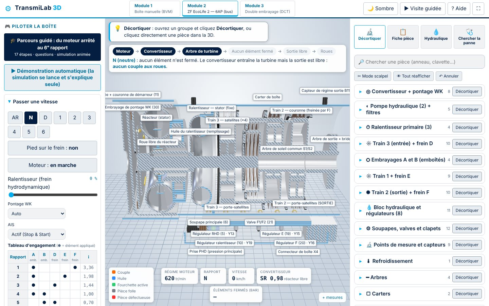
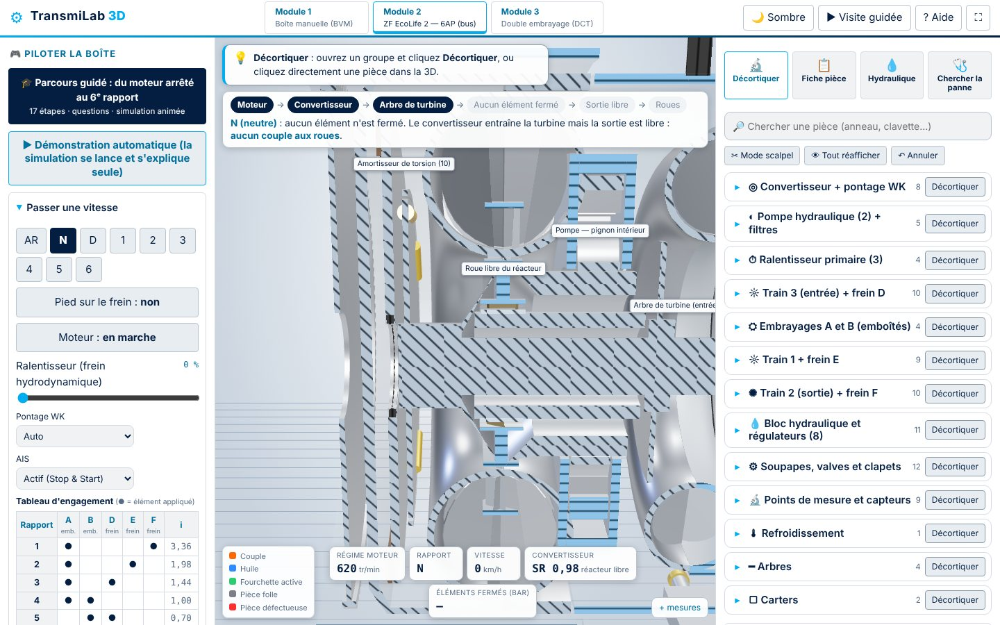
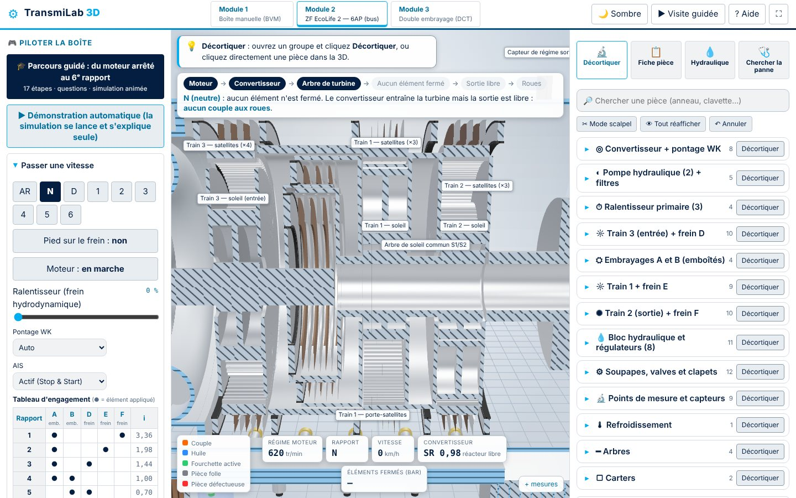
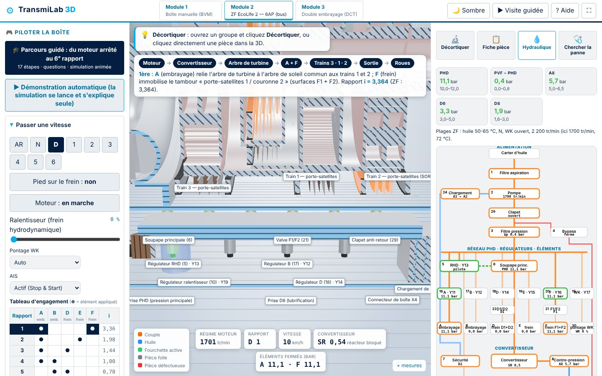
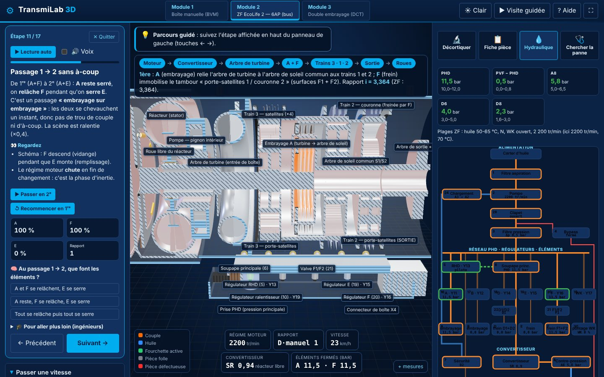
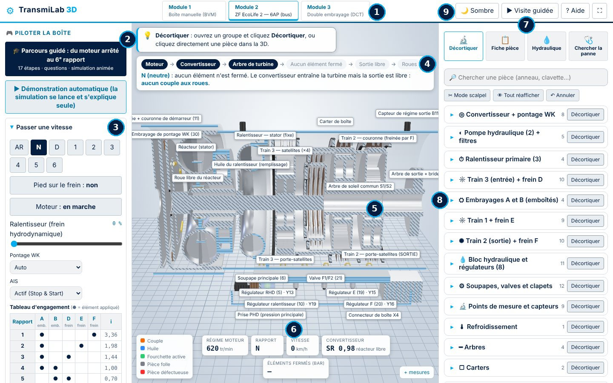
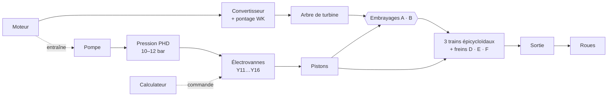
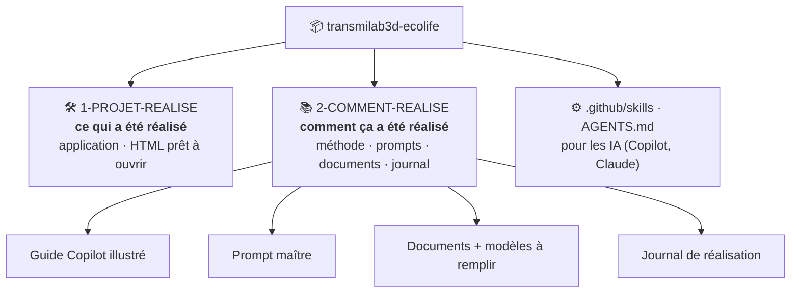
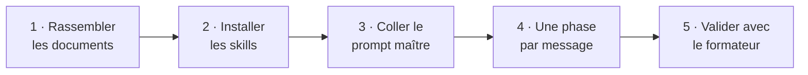

# TransmiLab 3D — Simulation de la boîte automatique ZF EcoLife 2

**Un simulateur 3D pour *voir* comment une boîte automatique de bus fonctionne : chaque élément, son influence sur la chaîne, du moteur arrêté jusqu'au 6ᵉ rapport.**
Pensé pour la formation technique, de l'élève technicien à l'ingénieur. Un fichier HTML, aucun serveur, fonctionne hors ligne.



## ▶ Essayer en 30 secondes

1. Ouvrir **[`1-PROJET-REALISE/livrables/TransmiLab3D_EcoLife.html`](1-PROJET-REALISE/livrables/TransmiLab3D_EcoLife.html)** (télécharger le fichier, puis double-clic).
2. Cliquer l'onglet **Module 2 — ZF EcoLife 2**.
3. Cliquer **« ▶ Démonstration automatique »** : la simulation se lance et chaque étape s'explique seule (≈ 7 à 8 min). Ou **« 🎓 Parcours guidé »** pour avancer étape par étape.

## Ce que l'on voit

| | |
|---|---|
|  **Le convertisseur** : roue-pompe, turbine, réacteur, pontage WK |  **Les trains épicycloïdaux** en coupe, freins et embrayages |
|  **Le circuit hydraulique** animé, avec les plages de pression du manuel |  **Le parcours guidé** : une idée par étape, mesures en direct, question |

## Comprendre l'écran



| # | Zone | À quoi ça sert |
|---|---|---|
| 1 | **Modules** | Module 1 boîte manuelle · **Module 2 ZF EcoLife 2** · Module 3 double embrayage (base) |
| 2 | **Parcours guidé / Démonstration automatique** | 17 étapes du moteur arrêté au 6ᵉ rapport ; pause, voix optionnelle |
| 3 | **Piloter la boîte** | D, 1…6, pied sur le frein, moteur, ralentisseur, pontage WK, AIS, tableau d'engagement |
| 4 | **Chaîne du couple** | quels éléments transmettent, du moteur aux roues, en direct |
| 5 | **Vue 3D en coupe** | cliquer une pièce pour sa fiche ; molette = zoom ; glisser = tourner |
| 6 | **Mesures en direct** | régime, rapport, vitesse, SR du convertisseur, pressions des éléments |
| 7 | **Analyse** | Décortiquer · Fiche pièce · **Hydraulique** · Chercher la panne |
| 8 | **Sous-ensembles** | isoler, écarter, démonter chaque groupe (convertisseur, trains, freins, bloc hydraulique…) |
| 9 | **Thème / visite guidée** | clair (par défaut) ou sombre ; aide |

## La chaîne de fonctionnement montrée



Chaque rapport = **2 éléments serrés** : 1 = A+F · 2 = A+E · 3 = A+D · 4 = A+B · 5 = B+D · 6 = B+E · AR = D+F.

## Ce dépôt : deux parties



| Partie | Dossier | Pour qui |
|---|---|---|
| 🛠 **Projet réalisé** | [`1-PROJET-REALISE/`](1-PROJET-REALISE/README.md) — code (`js/`, `css/`), Three.js embarqué, `livrables/`, `archive/` | élèves, formateurs, développeurs |
| 📚 **Comment réalisé** | [`2-COMMENT-REALISE/`](2-COMMENT-REALISE/README.md) | quiconque veut **refaire** la démarche sur une autre pièce |
| ⚙ **Pour les IA** | `.github/skills/` (5 skills) · `AGENTS.md` · `.github/copilot-instructions.md` · `CLAUDE.md` | GitHub Copilot, Claude Code |

<details>
<summary>📁 Arborescence détaillée</summary>

```
transmilab3d-ecolife/
├─ README.md                      ← vous êtes ici
├─ assets/img/                    ← captures utilisées par les README
├─ AGENTS.md · CLAUDE.md          ← règles du projet pour les IA
├─ .github/
│  ├─ copilot-instructions.md
│  └─ skills/                     ← les 5 skills (lus par Copilot)
├─ 1-PROJET-REALISE/
│  ├─ index.html · js/ · css/ · vendor/ · tools/
│  ├─ livrables/TransmiLab3D_EcoLife.html     ← version prête à ouvrir
│  └─ archive/lepelletier-v1/                 ← ancienne version, non utilisée
└─ 2-COMMENT-REALISE/
   ├─ 01-methode/                 ← guide en 10 étapes
   ├─ 02-skills/                  ← index + fichiers .skill importables
   ├─ 03-prompts/                 ← prompt maître
   ├─ 04-documents-a-fournir/     ← documents à rassembler + modèles
   ├─ 05-portage-copilot-librechat/  ← GUIDE-COPILOT.md (illustré)
   ├─ 06-journal/                 ← ce qui s'est réellement passé
   └─ 07-presentation/            ← scripts du PowerPoint
```
</details>

## Refaire la même chose pour une autre pièce



➡ **Commencer par le [Guide Copilot illustré](2-COMMENT-REALISE/05-portage-copilot-librechat/GUIDE-COPILOT.md)**, puis [le prompt maître](2-COMMENT-REALISE/03-prompts/PROMPT-MAITRE.md) et [les documents à fournir](2-COMMENT-REALISE/04-documents-a-fournir/DOCUMENTS-A-PREPARER.md).

## État du projet

| ✅ Fait | ⏳ Reste à faire |
|---|---|
| Simulation EcoLife 2 validée (rapports ≤ 0,06 % d'écart avec le manuel) | **Valider la cinématique des trains** avec le formateur (schéma constructeur) |
| Modèle 3D en coupe, 7 cas de panne, schéma hydraulique animé | Refaire la **présentation PowerPoint** (elle montre encore l'ancienne boîte) |
| Parcours guidé 17 étapes + démonstration automatique | Citer la **page du manuel** à chaque étape du parcours |
| Charte OMNIplus ON, clair/sombre, mobile 390 px | Tester la **voix** et un **vrai téléphone** ; tester les skills dans un **vrai Copilot** |
| Méthode, skills, prompts, modèles de documents | Pousser vers le Git d'entreprise (jeton personnel requis) |

## Honnêteté : donné, reconstruit, simplifié

- **Donné par le manuel ZF EcoLife 2** (fourni, *non* inclus dans ce dépôt) : rapports, pressions (PHD 10–12 bar…), plages de mesure, règles de diagnostic.
- **Reconstruit** : les liaisons internes des **trois trains épicycloïdaux** sont déduites par calcul pour retrouver le tableau de rapports ZF (écart 0,06 %). Le schéma cinématique constructeur n'était pas disponible → **à valider avec le formateur**.
- **Déduit / simplifié** : nombres de dents, implantation axiale (schéma fonctionnel), dynamique de pression / patinage / température (ordres de grandeur).
- **Design** : palette relevée sur le portail OMNIplus ON ; le logo et la police DaimlerCS (propriétaires) ne sont pas reproduits.

## Aller plus loin
[Journal de réalisation](2-COMMENT-REALISE/06-journal/JOURNAL-DE-REALISATION.md) · [Guide méthode](2-COMMENT-REALISE/01-methode/GUIDE-REPRODUIRE-UNE-PIECE.md) · [README du projet](1-PROJET-REALISE/README.md) · [Recette (liste de contrôle)](2-COMMENT-REALISE/04-documents-a-fournir/modeles/recette.md)
